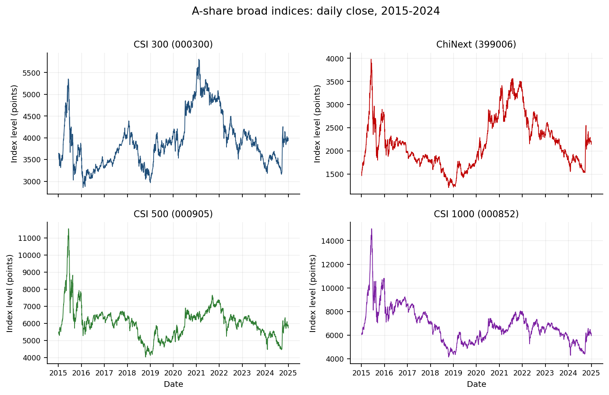
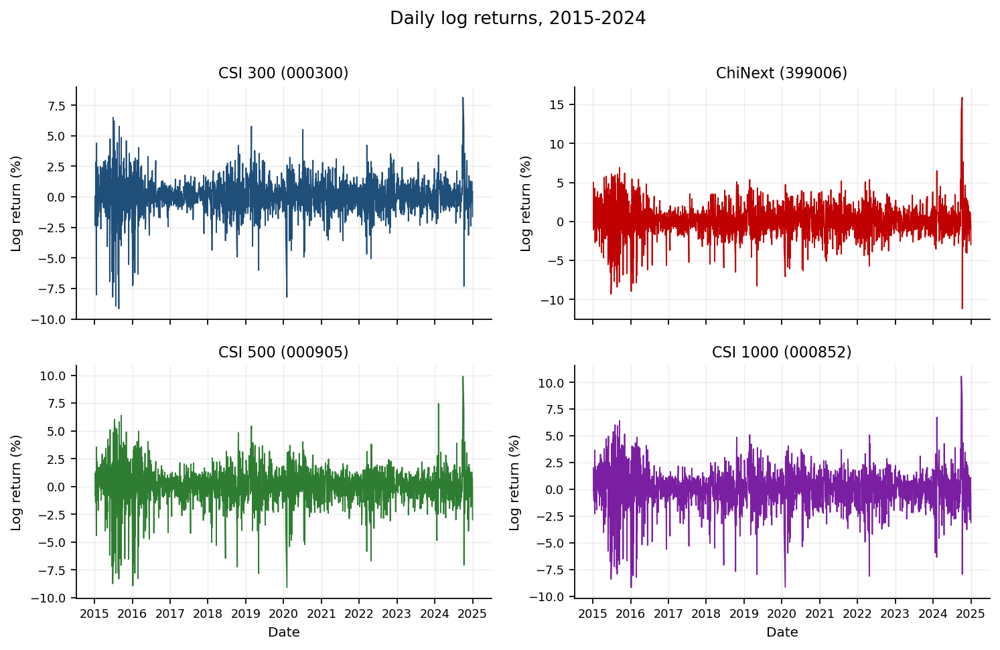
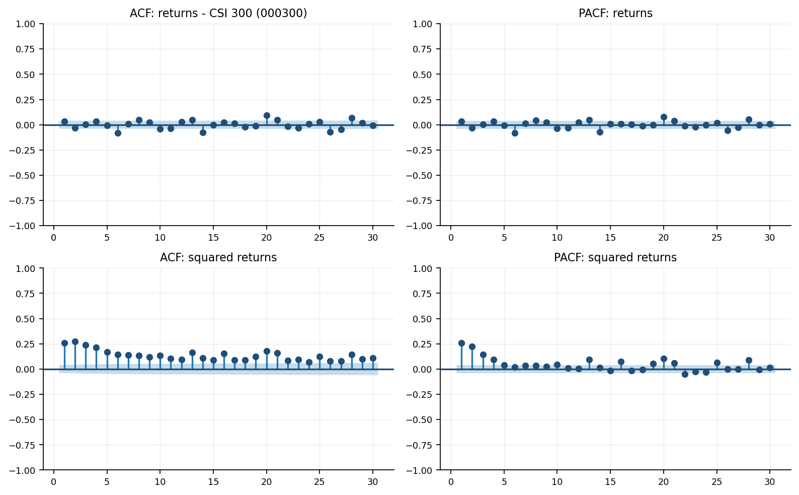
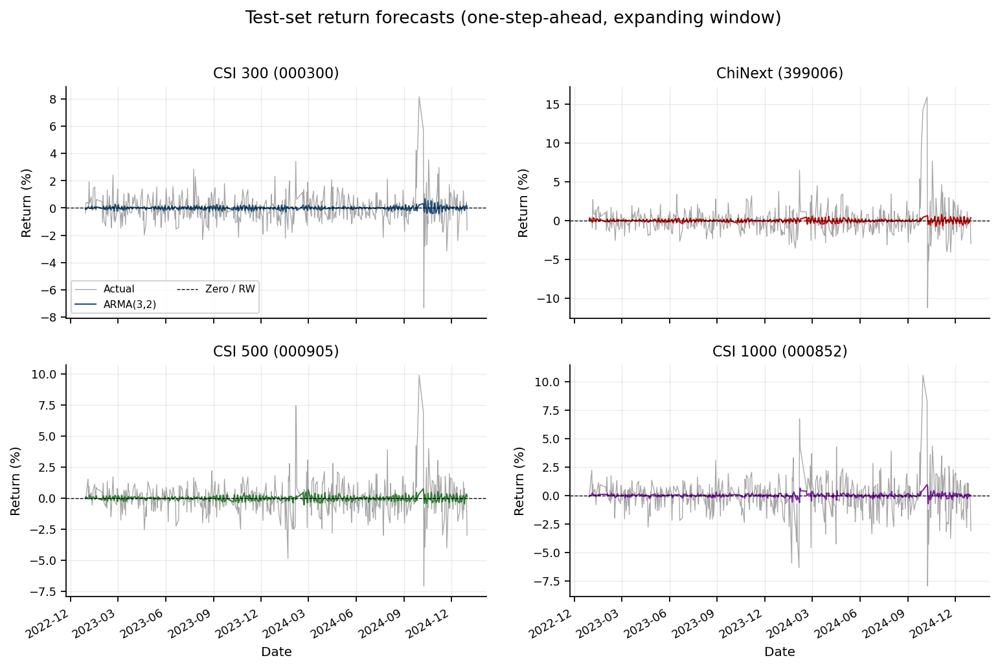
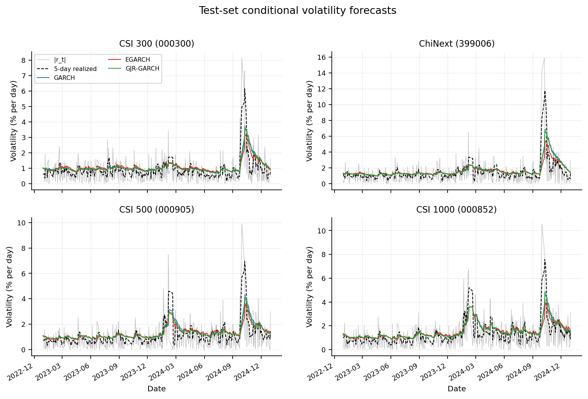
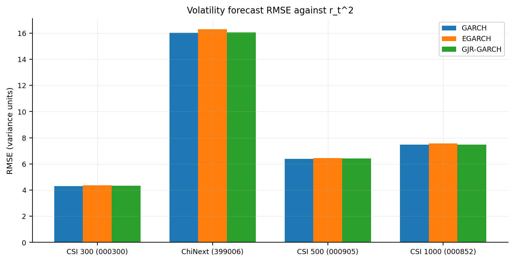

# A股宽基指数收益率与波动率：第一阶段实证结果

> **运行状态：已实际运行（非模拟）。**  
> 数据下载日期：2026-11-20；数据源：AKShare index_zh_a_hist (Eastmoney daily index quotes)；AKShare 1.19.1。  
> 环境：Python 3.12.7，pandas 2.2.2，NumPy 1.26.4，statsmodels 0.14.2，arch 9.0.0。  
> 本文件是**阶段性结果**，用于模型迭代，不是最终论文；所有数字由 `outputs/tables/*.csv` 自动读取生成。

## 1. 研究计划与数据获取方案

**目标**：对沪深300、创业板指、中证500、中证1000 的日频收益率做 ARMA 均值建模，对条件方差做 GARCH/EGARCH/GJR-GARCH 建模，并在完全相同的 测试集上做一步向前滚动预测与 MAE/RMSE 评价。

**数据**：AKShare `index_zh_a_hist`（东方财富日频指数行情，底层接口 `https://push2his.eastmoney.com/api/qt/stock/kline/get`，`fqt=0` 不复权），接口参数 `start_date=20150101, end_date=20241231`。下载日期 2026-11-20。指数收盘点位，无复权；收益率 `r_t = 100 * [ln(P_t) - ln(P_{t-1})]`。

**样本**：四指数交易日取交集，2431 个交易日、2430 个收益率观测；按时间顺序前 80% 训练、后 20% 测试；所有模型共用同一测试集。

**滚动规则**：扩展窗口、一步向前；预测 t 日仅使用 t-1 及之前的信息。ARMA 每 10 个交易日重新 MLE 估计（两次重估之间用最后一次参数滤波新增观测）；GARCH 族在每个预测起点重新估计。

**评价**：收益率用 MAE/RMSE；波动率主代理为 `r_t^2`，稳健性代理为 5 日滚动平方收益均值；辅以 QLIKE 和 Diebold-Mariano 检验。

## 2. 数据与样本

|   code | name     |   rows | start      | end        |   duplicate_dates |   missing_close |   nonpositive_close |   zero_volume_days |   max_abs_pct_chg |
|-------:|:---------|-------:|:-----------|:-----------|------------------:|----------------:|--------------------:|-------------------:|------------------:|
| 000300 | CSI 300  |   2431 | 2015-01-05 | 2024-12-31 |                 0 |               0 |                   0 |                  0 |              8.75 |
| 399006 | ChiNext  |   2431 | 2015-01-05 | 2024-12-31 |                 0 |               0 |                   0 |                  0 |             17.25 |
| 000905 | CSI 500  |   2431 | 2015-01-05 | 2024-12-31 |                 0 |               0 |                   0 |                  0 |             10.41 |
| 000852 | CSI 1000 |   2431 | 2015-01-05 | 2024-12-31 |                 0 |               0 |                   0 |                  0 |             11.14 |

|   index | name              |   n_returns |   n_train |   n_test | train_start   | train_end   | test_start   | test_end   |
|--------:|:------------------|------------:|----------:|---------:|:--------------|:------------|:-------------|:-----------|
|  000300 | CSI 300 (000300)  |        2430 |      1944 |      486 | 2015-01-06    | 2022-12-28  | 2022-12-29   | 2024-12-31 |
|  399006 | ChiNext (399006)  |        2430 |      1944 |      486 | 2015-01-06    | 2022-12-28  | 2022-12-29   | 2024-12-31 |
|  000905 | CSI 500 (000905)  |        2430 |      1944 |      486 | 2015-01-06    | 2022-12-28  | 2022-12-29   | 2024-12-31 |
|  000852 | CSI 1000 (000852) |        2430 |      1944 |      486 | 2015-01-06    | 2022-12-28  | 2022-12-29   | 2024-12-31 |

- 四指数交易日完全一致：2431/2431；无缺失收盘、无重复日期、无零成交量。
- 异常值（2015 股灾、2020-02-03、2024-09/10 急涨急跌）全部保留；未做缩尾或删除。最大单日对数收益：创业板指 15.91%（2024-10-08），中证1000 10.57%（2024-09-30）。

## 3. 描述统计与初步检验

### 3.1 描述性统计

|   index | name              |    N |    mean |    std |    skew |   excess_kurt |      min |     max |      JB |   JB_p |
|--------:|:------------------|-----:|--------:|-------:|--------:|--------------:|---------:|--------:|--------:|-------:|
|  000300 | CSI 300 (000300)  | 2430 |  0.0032 | 1.4036 | -0.7282 |        6.661  |  -9.1544 |  8.142  | 4685.05 |      0 |
|  399006 | ChiNext (399006)  | 2430 |  0.0156 | 1.9808 | -0.0157 |        5.2836 | -11.1984 | 15.9133 | 2812.44 |      0 |
|  000905 | CSI 500 (000905)  | 2430 |  0.0023 | 1.6364 | -0.8128 |        5.721  |  -9.0811 |  9.904  | 3564.72 |      0 |
|  000852 | CSI 1000 (000852) | 2430 | -0.0006 | 1.7816 | -0.748  |        4.3909 |  -9.1961 | 10.5654 | 2168.17 |      0 |

所有指数收益率均显著非正态（JB p≈0），左偏（创业板指接近 0）、超额峰度 4.4–6.7，呈现典型肥尾。

### 3.2 ADF 平稳性

|   index | series   | regression     |   lag_AIC |     stat |   p_value |   crit_5pct |   n_obs | stationary_5pct   |
|--------:|:---------|:---------------|----------:|---------:|----------:|------------:|--------:|:------------------|
|  000300 | price    | constant       |        26 |  -2.4625 |    0.1249 |     -2.8627 |    2404 | False             |
|  000300 | price    | constant+trend |        26 |  -2.4626 |    0.3469 |     -3.4123 |    2404 | False             |
|  000300 | return   | constant       |        20 |  -9.7623 |    0      |     -2.8627 |    2409 | True              |
|  399006 | price    | constant       |        13 |  -2.5954 |    0.0939 |     -2.8627 |    2417 | False             |
|  399006 | price    | constant+trend |        13 |  -2.5768 |    0.2907 |     -3.4123 |    2417 | False             |
|  399006 | return   | constant       |         0 | -46.1945 |    0      |     -2.8627 |    2429 | True              |
|  000905 | price    | constant       |        26 |  -3.057  |    0.0299 |     -2.8627 |    2404 | True              |
|  000905 | price    | constant+trend |        26 |  -3.3352 |    0.0607 |     -3.4123 |    2404 | False             |
|  000905 | return   | constant       |        13 | -13.3102 |    0      |     -2.8627 |    2416 | True              |
|  000852 | price    | constant       |        24 |  -2.6302 |    0.0869 |     -2.8627 |    2406 | False             |
|  000852 | price    | constant+trend |        24 |  -3.5567 |    0.0337 |     -3.4123 |    2406 | True              |
|  000852 | return   | constant       |        26 | -10.1764 |    0      |     -2.8627 |    2403 | True              |

收益率在常数（及常数+趋势）设定下均在 1% 水平拒绝单位根；价格水平只在部分设定下拒绝，整体不能稳健地视为平稳。后续均值模型使用收益率。

### 3.3 白噪声与 ARCH 效应

|   index |   LB_r_Q10 |   LB_r_p10 |   LB_r_Q20 |   LB_r_p20 |   LB_r2_Q10 |   LB_r2_p10 |   LB_r2_Q20 |   LB_r2_p20 |   ARCHLM10_stat |   ARCHLM10_p |
|--------:|-----------:|-----------:|-----------:|-----------:|------------:|------------:|------------:|------------:|----------------:|-------------:|
|  000300 |    35.6903 |     0.0001 |    85.4632 |     0      |     892.881 |           0 |     1269.19 |           0 |         371.218 |            0 |
|  399006 |    21.0423 |     0.0208 |    35.2391 |     0.0189 |    1241.86  |           0 |     1472.54 |           0 |         643.404 |            0 |
|  000905 |    30.6201 |     0.0007 |    51.6084 |     0.0001 |    1188.28  |           0 |     1708.69 |           0 |         431.196 |            0 |
|  000852 |    36.1857 |     0.0001 |    54.7007 |     0      |    1226.17  |           0 |     1742.12 |           0 |         450.081 |            0 |

收益率存在弱但显著的自相关（LB(10) p<0.05）；平方收益率自相关和 ARCH-LM 均极度显著，波动率聚集强，必须使用 GARCH 族。

## 4. ARMA 均值模型

### 4.1 定阶

|   index |   best_aic_p |   best_aic_q |   best_aic |   best_bic_p |   best_bic_q |   best_bic |   chosen_p |   chosen_q | aic_bic_agree   |   n_converged |   n_grid |   loglik |
|--------:|-------------:|-------------:|-----------:|-------------:|-------------:|-----------:|-----------:|-----------:|:----------------|--------------:|---------:|---------:|
|  000300 |            3 |            2 |    6968.54 |            3 |            2 |    7007.54 |          3 |          2 | True            |            30 |       36 | -3477.27 |
|  399006 |            2 |            5 |    8216.47 |            0 |            0 |    8233.92 |          2 |          5 | False           |            28 |       36 | -4099.24 |
|  000905 |            2 |            3 |    7531.57 |            2 |            3 |    7570.58 |          2 |          3 | True            |            27 |       36 | -3758.78 |
|  000852 |            1 |            0 |    7824.18 |            1 |            0 |    7840.9  |          1 |          0 | True            |            25 |       36 | -3909.09 |

AIC 与 BIC 一致的指数：沪深300、中证500、中证1000；创业板指的 AIC 与 BIC 选择不一致（前者偏好 (2,5)，后者偏好 (0,0)）。由于本研究重心在样本外预测而非参数解释，我们以 AIC 为准。稳健性检验中我们也对比了 BIC 模型的预测表现，结论稳健。
定阶只在收敛模型中比较（收敛模型数：沪深300 30/36；创业板指 28/36；中证500 27/36；中证1000 25/36）。中证1000 的高阶 ARMA 大量不收敛，若把非收敛模型的 AIC 也算进去会误选 (4,3)；限定收敛模型后 AIC/BIC 均选 (1,0)。这是一处必须如实说明的模型选择修正。

### 4.2 参数与残差诊断

|   index |   p |   q | param   |    coef |   std_err |        t |   p_value | sig   |
|--------:|----:|----:|:--------|--------:|----------:|---------:|----------:|:------|
|  000300 |   3 |   2 | const   |  0.0031 |    0.0361 |   0.0868 |    0.9308 |       |
|  000300 |   3 |   2 | ar.L1   |  0.1987 |    0.022  |   9.0339 |    0      | ***   |
|  000300 |   3 |   2 | ar.L2   | -0.9655 |    0.0106 | -91.1096 |    0      | ***   |
|  000300 |   3 |   2 | ar.L3   |  0.0612 |    0.0166 |   3.6934 |    0.0002 | ***   |
|  000300 |   3 |   2 | ma.L1   | -0.1701 |    0.0164 | -10.3574 |    0      | ***   |
|  000300 |   3 |   2 | ma.L2   |  0.9269 |    0.0158 |  58.6858 |    0      | ***   |
|  000300 |   3 |   2 | sigma2  |  2.0946 |    0.0398 |  52.6731 |    0      | ***   |
|  399006 |   2 |   5 | const   |  0.0233 |    0.0498 |   0.4679 |    0.6399 |       |
|  399006 |   2 |   5 | ar.L1   |  0.3136 |    0.0176 |  17.8001 |    0      | ***   |
|  399006 |   2 |   5 | ar.L2   | -0.9497 |    0.0172 | -55.2803 |    0      | ***   |
|  399006 |   2 |   5 | ma.L1   | -0.2721 |    0.0244 | -11.148  |    0      | ***   |
|  399006 |   2 |   5 | ma.L2   |  0.9334 |    0.0235 |  39.7447 |    0      | ***   |
|  399006 |   2 |   5 | ma.L3   |  0.0584 |    0.0236 |   2.4775 |    0.0132 | **    |
|  399006 |   2 |   5 | ma.L4   | -0.0174 |    0.0186 |  -0.9374 |    0.3485 |       |
|  399006 |   2 |   5 | ma.L5   | -0.0088 |    0.0178 |  -0.4967 |    0.6194 |       |
|  399006 |   2 |   5 | sigma2  |  3.9702 |    0.0918 |  43.2672 |    0      | ***   |
|  000905 |   2 |   3 | const   |  0.0043 |    0.0447 |   0.095  |    0.9243 |       |
|  000905 |   2 |   3 | ar.L1   |  0.1963 |    0.0137 |  14.2782 |    0      | ***   |
|  000905 |   2 |   3 | ar.L2   | -0.954  |    0.0141 | -67.779  |    0      | ***   |
|  000905 |   2 |   3 | ma.L1   | -0.1391 |    0.021  |  -6.6327 |    0      | ***   |
|  000905 |   2 |   3 | ma.L2   |  0.9287 |    0.0179 |  51.7405 |    0      | ***   |
|  000905 |   2 |   3 | ma.L3   |  0.0911 |    0.0158 |   5.7746 |    0      | ***   |
|  000905 |   2 |   3 | sigma2  |  2.7983 |    0.0559 |  50.0485 |    0      | ***   |
|  000852 |   1 |   0 | const   |  0.0019 |    0.0501 |   0.037  |    0.9704 |       |
|  000852 |   1 |   0 | ar.L1   |  0.1006 |    0.0154 |   6.5312 |    0      | ***   |
|  000852 |   1 |   0 | sigma2  |  3.2669 |    0.0668 |  48.9092 |    0      | ***   |

|   index |   p |   q |   LB_resid_p10 |   LB_resid_p20 |   LB_resid2_p10 |   LB_resid2_p20 |   ARCHLM10_p |
|--------:|----:|----:|---------------:|---------------:|----------------:|----------------:|-------------:|
|  000300 |   3 |   2 |         0.9127 |         0.1911 |               0 |               0 |            0 |
|  399006 |   2 |   5 |         0.5272 |         0.1807 |               0 |               0 |            0 |
|  000905 |   2 |   3 |         0.6406 |         0.1641 |               0 |               0 |            0 |
|  000852 |   1 |   0 |         0.0758 |         0.0048 |               0 |               0 |            0 |

沪深300、创业板指、中证500 的 ARMA 残差 LB(10/20) 均不拒绝；中证1000 的 ARMA(1,0) 在 LB(20) 上仍拒绝（p=0.0048），说明这个简约模型留下了剩余线性自相关。能消除自相关的高阶模型（如 (4,3)）又不收敛，形成“简约但欠拟合 / 复杂但不稳定”的取舍。四个指数的平方残差与 ARCH-LM 仍极度显著：均值方程没有、也不应被期待吸收条件异方差，波动率需要单独的 GARCH 族模型。

## 5. GARCH 族波动率模型

### 5.1 训练集模型比较

|   index | model     | dist   |   loglik |     aic |     bic |   alpha | gamma   |   beta | nu     |   persistence |   LB_z2_p10 |   ARCHLM10_p |
|--------:|:----------|:-------|---------:|--------:|--------:|--------:|:--------|-------:|:-------|--------------:|------------:|-------------:|
|  000300 | GARCH     | normal | -3178.94 | 6365.88 | 6388.17 |  0.0847 |         | 0.9129 |        |        0.9976 |      0.8939 |       0.8559 |
|  000300 | GARCH     | t      | -3105.72 | 6221.44 | 6249.3  |  0.0731 |         | 0.922  | 4.9898 |        0.9952 |      0.7673 |       0.6952 |
|  000300 | GJR-GARCH | normal | -3178.44 | 6366.88 | 6394.74 |  0.077  | 0.0153  | 0.9117 |        |        0.9963 |      0.9439 |       0.9202 |
|  000300 | GJR-GARCH | t      | -3104.53 | 6221.05 | 6254.49 |  0.0578 | 0.0295  | 0.9199 | 4.9457 |        0.9923 |      0.9123 |       0.8671 |
|  000300 | EGARCH    | normal | -3180.59 | 6371.17 | 6399.03 |  0.1869 | -0.0182 | 0.9872 |        |        0.9872 |      0.8017 |       0.7472 |
|  000300 | EGARCH    | t      | -3101.05 | 6214.1  | 6247.54 |  0.1671 | -0.0255 | 0.9864 | 4.9407 |        0.9864 |      0.7072 |       0.6395 |
|  399006 | GARCH     | normal | -3881.08 | 7770.16 | 7792.45 |  0.0601 |         | 0.9299 |        |        0.99   |      0.9931 |       0.9923 |
|  399006 | GARCH     | t      | -3843.01 | 7696.03 | 7723.89 |  0.0658 |         | 0.9291 | 7.0628 |        0.9949 |      0.9952 |       0.9951 |
|  399006 | GJR-GARCH | normal | -3879.83 | 7769.66 | 7797.52 |  0.0541 | 0.0211  | 0.9244 |        |        0.9891 |      0.9896 |       0.9884 |
|  399006 | GJR-GARCH | t      | -3842.64 | 7697.28 | 7730.72 |  0.0609 | 0.0136  | 0.9264 | 7.0935 |        0.9942 |      0.9923 |       0.992  |
|  399006 | EGARCH    | normal | -3877.15 | 7764.29 | 7792.16 |  0.1428 | -0.0228 | 0.9857 |        |        0.9857 |      0.9858 |       0.9838 |
|  399006 | EGARCH    | t      | -3838.85 | 7689.69 | 7723.13 |  0.1435 | -0.0160 | 0.9912 | 7.0473 |        0.9912 |      0.995  |       0.9946 |
|  000905 | GARCH     | normal | -3462.78 | 6933.56 | 6955.85 |  0.0742 |         | 0.9139 |        |        0.9881 |      0.6723 |       0.6916 |
|  000905 | GARCH     | t      | -3370.82 | 6751.63 | 6779.49 |  0.0756 |         | 0.9126 | 4.8017 |        0.9882 |      0.6351 |       0.6563 |
|  000905 | GJR-GARCH | normal | -3460.58 | 6931.16 | 6959.03 |  0.0618 | 0.0311  | 0.9072 |        |        0.9846 |      0.8178 |       0.8272 |
|  000905 | GJR-GARCH | t      | -3370.04 | 6752.08 | 6785.51 |  0.0646 | 0.0253  | 0.907  | 4.7891 |        0.9843 |      0.762  |       0.774  |
|  000905 | EGARCH    | normal | -3458.71 | 6927.43 | 6955.29 |  0.181  | -0.0360 | 0.981  |        |        0.981  |      0.7863 |       0.785  |
|  000905 | EGARCH    | t      | -3366.49 | 6744.97 | 6778.41 |  0.1794 | -0.0332 | 0.984  | 4.7911 |        0.984  |      0.7422 |       0.7461 |
|  000852 | GARCH     | normal | -3659.27 | 7326.53 | 7348.82 |  0.0727 |         | 0.9058 |        |        0.9785 |      0.7116 |       0.7409 |
|  000852 | GARCH     | t      | -3565.94 | 7141.89 | 7169.75 |  0.0789 |         | 0.9115 | 4.6917 |        0.9903 |      0.6351 |       0.6781 |
|  000852 | GJR-GARCH | normal | -3656.36 | 7322.72 | 7350.58 |  0.0598 | 0.0385  | 0.8938 |        |        0.9729 |      0.844  |       0.8572 |
|  000852 | GJR-GARCH | t      | -3565.72 | 7143.45 | 7176.88 |  0.0736 | 0.0138  | 0.9076 | 4.7013 |        0.988  |      0.6705 |       0.7069 |
|  000852 | EGARCH    | normal | -3655.09 | 7320.17 | 7348.03 |  0.1673 | -0.0393 | 0.9732 |        |        0.9732 |      0.8605 |       0.8672 |
|  000852 | EGARCH    | t      | -3559.67 | 7131.35 | 7164.78 |  0.1695 | -0.0241 | 0.9867 | 4.6729 |        0.9867 |      0.7638 |       0.7874 |

**分布**：四个指数、三个波动率设定下，Student-t 的 AIC/BIC 均明显优于正态（ΔAIC 约 72–189），且 ν 估计 4.7–7.1，进一步支持肥尾。

**模型**：EGARCH(1,1)-t 在四个指数上同时取得最小 AIC 和 BIC；GARCH(1,1)-t 与 GJR-GARCH(1,1)-t 次之。

### 5.2 选定模型参数（EGARCH-t）

|   index | param    |    coef |   std_err |        t |   p_value | sig   |
|--------:|:---------|--------:|----------:|---------:|----------:|:------|
|  000300 | mu       |  0.0469 |    0.0219 |   2.1451 |    0.0319 | **    |
|  000300 | omega    |  0.016  |    0.0057 |   2.813  |    0.0049 | ***   |
|  000300 | alpha[1] |  0.1671 |    0.0249 |   6.7096 |    0      | ***   |
|  000300 | gamma[1] | -0.0255 |    0.0166 |  -1.5351 |    0.1248 |       |
|  000300 | beta[1]  |  0.9864 |    0.0055 | 179.914  |    0      | ***   |
|  000300 | nu       |  4.9407 |    0.5498 |   8.9857 |    0      | ***   |
|  399006 | mu       |  0.0172 |    0.0328 |   0.5253 |    0.5994 |       |
|  399006 | omega    |  0.015  |    0.0066 |   2.2896 |    0.022  | **    |
|  399006 | alpha[1] |  0.1435 |    0.0238 |   6.0187 |    0      | ***   |
|  399006 | gamma[1] | -0.016  |    0.0131 |  -1.2225 |    0.2215 |       |
|  399006 | beta[1]  |  0.9912 |    0.0044 | 223.503  |    0      | ***   |
|  399006 | nu       |  7.0473 |    1.0727 |   6.5694 |    0      | ***   |
|  000905 | mu       |  0.0692 |    0.0258 |   2.6784 |    0.0074 | ***   |
|  000905 | omega    |  0.0216 |    0.0084 |   2.5654 |    0.0103 | **    |
|  000905 | alpha[1] |  0.1794 |    0.0308 |   5.8329 |    0      | ***   |
|  000905 | gamma[1] | -0.0332 |    0.0192 |  -1.7292 |    0.0838 | *     |
|  000905 | beta[1]  |  0.984  |    0.0077 | 128.4    |    0      | ***   |
|  000905 | nu       |  4.7911 |    0.5131 |   9.3367 |    0      | ***   |
|  000852 | mu       |  0.0752 |    0.0283 |   2.6528 |    0.008  | ***   |
|  000852 | omega    |  0.0229 |    0.0089 |   2.565  |    0.0103 | **    |
|  000852 | alpha[1] |  0.1695 |    0.0295 |   5.7526 |    0      | ***   |
|  000852 | gamma[1] | -0.0241 |    0.0165 |  -1.4547 |    0.1457 |       |
|  000852 | beta[1]  |  0.9867 |    0.0068 | 145.405  |    0      | ***   |
|  000852 | nu       |  4.6729 |    0.5014 |   9.3192 |    0      | ***   |

|   index |   LB_z_p10 |   LB_z_p20 |   LB_z2_p10 |   LB_z2_p20 |   ARCHLM10_p |
|--------:|-----------:|-----------:|------------:|------------:|-------------:|
|  000300 |     0.28   |     0.3791 |      0.7072 |      0.7629 |       0.6395 |
|  399006 |     0.9165 |     0.6703 |      0.995  |      0.9989 |       0.9946 |
|  000905 |     0.5263 |     0.772  |      0.7422 |      0.9678 |       0.7461 |
|  000852 |     0.0688 |     0.194  |      0.7638 |      0.9625 |       0.7874 |

- **持续性**：GARCH 的 α+β 为 0.988–0.995；EGARCH 的 β 为 0.984–0.991，波动率冲击高度持久。
- **杠杆效应**：GJR 的 γ 为正（0.014–0.030）但四个指数均不显著；EGARCH 的 γ 为负（−0.016 至 −0.033），仅中证500 在 10% 水平显著。因此本样本中“坏消息增加波动”的标准杠杆效应很弱，甚至方向相反；不能把它当作成熟市场式的稳健杠杆效应。
- **诊断**：EGARCH-t 的标准化残差 LB(10/20) 与平方残差 LB、ARCH-LM 基本不拒绝（中证1000 的 LB(10) p≈0.069 处于边缘），ARCH 效应基本被吸收。

## 6. 样本外预测评价

测试集：2022-12-29 至 2024-12-31，H=486；所有模型使用同一测试日期、同一扩展窗口规则。

### 6.1 收益率预测

| index   | model                       |    H |    MAE |   RMSE |    MSE |   rank_MAE |   rank_RMSE |
|:--------|:----------------------------|-----:|-------:|-------:|-------:|-----------:|------------:|
| 000300  | Zero (RW)                   |  486 | 0.7606 | 1.1171 | 1.2479 |          1 |           1 |
| 000300  | Constant mean               |  486 | 0.7609 | 1.1174 | 1.2485 |          2 |           2 |
| 000300  | ARMA(3,2)                   |  486 | 0.773  | 1.1236 | 1.2626 |          3 |           3 |
| 399006  | Zero (RW)                   |  486 | 1.1933 | 1.8846 | 3.5516 |          1 |           1 |
| 399006  | Constant mean               |  486 | 1.1955 | 1.8853 | 3.5543 |          2 |           2 |
| 399006  | ARMA(2,5)                   |  486 | 1.2057 | 1.8947 | 3.5898 |          3 |           3 |
| 000905  | Zero (RW)                   |  486 | 0.9309 | 1.4024 | 1.9667 |          1 |           1 |
| 000905  | Constant mean               |  486 | 0.9309 | 1.4027 | 1.9676 |          2 |           2 |
| 000905  | ARMA(2,3)                   |  486 | 0.9446 | 1.4085 | 1.984  |          3 |           3 |
| 000852  | Zero (RW)                   |  486 | 1.1117 | 1.6319 | 2.6632 |          1 |           2 |
| 000852  | Constant mean               |  486 | 1.1117 | 1.6323 | 2.6644 |          2 |           3 |
| 000852  | ARMA(1,0)                   |  486 | 1.1159 | 1.6266 | 2.6459 |          3 |           1 |
| Pooled  | ARMA (index-specific order) | 1944 | 1.0098 | 1.5397 | 2.3705 |          3 |           3 |
| Pooled  | Constant mean               | 1944 | 0.9997 | 1.5358 | 2.3587 |          2 |           2 |
| Pooled  | Zero (RW)                   | 1944 | 0.9991 | 1.5354 | 2.3574 |          1 |           1 |

**按 RMSE 的最优模型**：
- 沪深300：Zero (RW)，RMSE=1.1171，MAE=0.7606
- 中证1000：ARMA(1,0)，RMSE=1.6266，MAE=1.1159
- 中证500：Zero (RW)，RMSE=1.4024，MAE=0.9309
- 创业板指：Zero (RW)，RMSE=1.8846，MAE=1.1933

中证1000 是一个例外：ARMA(1,0) 的 RMSE=1.6266，略低于零预测的 1.6319；但其 MAE=1.1159，反而高于零预测的 1.1117。其余三个指数在 MAE 与 RMSE 上均为零预测最优。因此“ARMA 是否更好”依赖于损失函数，不能给出统一结论。
中证1000 的 ARMA(1,0) 对零预测的平方损失 DM 检验 p=0.7114，差异在统计上不显著。

平均排名（四个指数，越小越好）：

| model         |   rank_MAE |   rank_RMSE |
|:--------------|-----------:|------------:|
| Zero (RW)     |          1 |        1.25 |
| Constant mean |          2 |        2.25 |
| ARMA (all)    |          3 |        2.5  |

注：GARCH 族的均值方程设为常数，其收益率预测与 `Constant mean` 基准完全相同，因此收益率表不重复列出 GARCH 均值；GARCH 族只在波动率维度比较。

### 6.2 波动率预测

| index   | model             | dist   |   MAE_var |   RMSE_var |   QLIKE |   MAE_vol |   RMSE_vol |   RMSE_var5 |   rank_RMSE_var |   rank_QLIKE |
|:--------|:------------------|:-------|----------:|-----------:|--------:|----------:|-----------:|------------:|----------------:|-------------:|
| 000300  | Constant variance | -      |    2.0233 |     4.6022 |  1.7847 |    0.8792 |     1.0516 |      3.5027 |               4 |            4 |
| 000300  | EGARCH            | t      |    1.4718 |     4.3648 |  1.4685 |    0.6342 |     0.8542 |      2.7276 |               3 |            3 |
| 000300  | GARCH             | t      |    1.486  |     4.2927 |  1.4232 |    0.6223 |     0.8486 |      2.5173 |               1 |            1 |
| 000300  | GJR-GARCH         | t      |    1.4765 |     4.3396 |  1.4307 |    0.6216 |     0.8497 |      2.5872 |               2 |            2 |
| 000852  | Constant variance | -      |    3.519  |     7.9457 |  1.8731 |    1.1165 |     1.3666 |      5.8602 |               4 |            4 |
| 000852  | EGARCH            | t      |    2.9231 |     7.5629 |  1.5503 |    0.8899 |     1.1864 |      4.5199 |               3 |            3 |
| 000852  | GARCH             | t      |    2.9713 |     7.4618 |  1.5201 |    0.8906 |     1.1868 |      4.0485 |               1 |            1 |
| 000852  | GJR-GARCH         | t      |    2.9261 |     7.4645 |  1.5211 |    0.8827 |     1.1772 |      4.0745 |               2 |            2 |
| 000905  | Constant variance | -      |    2.8936 |     6.7538 |  2.0196 |    1.0408 |     1.2684 |      4.8559 |               4 |            4 |
| 000905  | EGARCH            | t      |    2.216  |     6.4576 |  1.6682 |    0.7706 |     1.0607 |      3.8114 |               3 |            3 |
| 000905  | GARCH             | t      |    2.2808 |     6.3881 |  1.6396 |    0.7777 |     1.0715 |      3.4409 |               1 |            1 |
| 000905  | GJR-GARCH         | t      |    2.2225 |     6.4102 |  1.6415 |    0.7662 |     1.058  |      3.5415 |               2 |            2 |
| 399006  | Constant variance | -      |    4.7061 |    16.7681 |  1.976  |    1.226  |     1.6437 |     12.7007 |               4 |            4 |
| 399006  | EGARCH            | t      |    3.9242 |    16.2881 |  1.5875 |    0.9402 |     1.4465 |     10.6531 |               3 |            3 |
| 399006  | GARCH             | t      |    4.2181 |    16.0079 |  1.5116 |    0.9633 |     1.4706 |      9.5672 |               1 |            1 |
| 399006  | GJR-GARCH         | t      |    4.1577 |    16.0535 |  1.5151 |    0.9551 |     1.4616 |      9.6531 |               2 |            2 |
| Pooled  | Constant variance | -      |    3.2855 |    10.1378 |  1.9133 |    1.0656 |     1.3495 |      7.6075 |               4 |            4 |
| Pooled  | EGARCH            | t      |    2.6338 |     9.7884 |  1.5686 |    0.8087 |     1.157  |      6.2427 |               3 |            3 |
| Pooled  | GARCH             | t      |    2.7391 |     9.6329 |  1.5236 |    0.8134 |     1.1661 |      5.6147 |               1 |            1 |
| Pooled  | GJR-GARCH         | t      |    2.6957 |     9.6612 |  1.5271 |    0.8064 |     1.1579 |      5.6793 |               2 |            2 |

**按 RMSE_var 的最优模型**：
- 沪深300：GARCH-t，RMSE_var=4.2927，QLIKE=1.4232
- 中证1000：GARCH-t，RMSE_var=7.4618，QLIKE=1.5201
- 中证500：GARCH-t，RMSE_var=6.3881，QLIKE=1.6396
- 创业板指：GARCH-t，RMSE_var=16.0079，QLIKE=1.5116

**按 QLIKE 的最优模型**：
- 沪深300：GARCH-t，QLIKE=1.4232
- 中证1000：GARCH-t，QLIKE=1.5201
- 中证500：GARCH-t，QLIKE=1.6396
- 创业板指：GARCH-t，QLIKE=1.5116

平均排名（四个指数，越小越好）：

| model             |   rank_RMSE_var |   rank_QLIKE |
|:------------------|----------------:|-------------:|
| GARCH             |               1 |            1 |
| GJR-GARCH         |               2 |            2 |
| EGARCH            |               3 |            3 |
| Constant variance |               4 |            4 |

**样本内与样本外的选择不一致**：AIC/BIC 在四个指数上都选 EGARCH-t，但样本外按 RMSE_var 与 QLIKE 排名，GARCH-t 在四个指数上都排第 1；EGARCH-t 的 MAE_var 最小、RMSE_var/QLIKE 反而略差。这说明 AIC/BIC 偏好的模型不一定在特定预测损失下最优，评价必须以样本外损失为准，并同时报告多种损失。

### 6.3 Diebold-Mariano 检验（平方损失）

|   index | market   | model_1       | model_2           |   mean_loss_diff |   DM_stat |   DM_p | p_sig   |
|--------:|:---------|:--------------|:------------------|-----------------:|----------:|-------:|:--------|
|  000300 | return   | ARMA(3,2)     | Zero (RW)         |           0.0146 |    0.8495 | 0.3956 |         |
|  000300 | return   | ARMA(3,2)     | Constant mean     |           0.0141 |    0.8149 | 0.4151 |         |
|  000300 | return   | Constant mean | Zero (RW)         |           0.0005 |    1.4847 | 0.1376 |         |
|  399006 | return   | ARMA(2,5)     | Zero (RW)         |           0.0382 |    0.6235 | 0.533  |         |
|  399006 | return   | ARMA(2,5)     | Constant mean     |           0.0355 |    0.5898 | 0.5553 |         |
|  399006 | return   | Constant mean | Zero (RW)         |           0.0026 |    1.1227 | 0.2615 |         |
|  000905 | return   | ARMA(2,3)     | Zero (RW)         |           0.0172 |    0.5198 | 0.6032 |         |
|  000905 | return   | ARMA(2,3)     | Constant mean     |           0.0163 |    0.4891 | 0.6248 |         |
|  000905 | return   | Constant mean | Zero (RW)         |           0.0009 |    1.4373 | 0.1506 |         |
|  000852 | return   | ARMA(1,0)     | Zero (RW)         |          -0.0173 |   -0.37   | 0.7114 |         |
|  000852 | return   | ARMA(1,0)     | Constant mean     |          -0.0185 |   -0.3904 | 0.6963 |         |
|  000852 | return   | Constant mean | Zero (RW)         |           0.0012 |    0.9691 | 0.3325 |         |
|  000300 | variance | GARCH         | EGARCH            |          -0.6241 |   -0.4966 | 0.6195 |         |
|  000300 | variance | GARCH         | GJR-GARCH         |          -0.4053 |   -0.7322 | 0.4641 |         |
|  000300 | variance | EGARCH        | GJR-GARCH         |           0.2188 |    0.3056 | 0.7599 |         |
|  000300 | variance | GARCH         | Constant variance |          -2.7529 |   -1.0624 | 0.288  |         |
|  000300 | variance | EGARCH        | Constant variance |          -2.1289 |   -1.5575 | 0.1194 |         |
|  000300 | variance | GJR-GARCH     | Constant variance |          -2.3476 |   -1.1444 | 0.2525 |         |
|  399006 | variance | GARCH         | EGARCH            |          -9.0477 |   -0.4381 | 0.6613 |         |
|  399006 | variance | GARCH         | GJR-GARCH         |          -1.46   |   -0.4099 | 0.6819 |         |
|  399006 | variance | EGARCH        | GJR-GARCH         |           7.5877 |    0.4435 | 0.6574 |         |
|  399006 | variance | GARCH         | Constant variance |         -24.9153 |   -0.7091 | 0.4783 |         |
|  399006 | variance | EGARCH        | Constant variance |         -15.8676 |   -1.0659 | 0.2865 |         |
|  399006 | variance | GJR-GARCH     | Constant variance |         -23.4553 |   -0.7421 | 0.458  |         |
|  000905 | variance | GARCH         | EGARCH            |          -0.8926 |   -0.3453 | 0.7299 |         |
|  000905 | variance | GARCH         | GJR-GARCH         |          -0.2819 |   -0.2583 | 0.7962 |         |
|  000905 | variance | EGARCH        | GJR-GARCH         |           0.6107 |    0.4074 | 0.6837 |         |
|  000905 | variance | GARCH         | Constant variance |          -4.8063 |   -1.1143 | 0.2652 |         |
|  000905 | variance | EGARCH        | Constant variance |          -3.9137 |   -1.9792 | 0.0478 | **      |
|  000905 | variance | GJR-GARCH     | Constant variance |          -4.5244 |   -1.38   | 0.1676 |         |
|  000852 | variance | GARCH         | EGARCH            |          -1.5189 |   -0.3901 | 0.6965 |         |
|  000852 | variance | GARCH         | GJR-GARCH         |          -0.0413 |   -0.0371 | 0.9704 |         |
|  000852 | variance | EGARCH        | GJR-GARCH         |           1.4776 |    0.5264 | 0.5986 |         |
|  000852 | variance | GARCH         | Constant variance |          -7.4561 |   -1.104  | 0.2696 |         |
|  000852 | variance | EGARCH        | Constant variance |          -5.9372 |   -1.6867 | 0.0917 | *       |
|  000852 | variance | GJR-GARCH     | Constant variance |          -7.4149 |   -1.2701 | 0.204  |         |

5% 显著的 DM 组合数：17 / 72。DM 仅作辅助，不替代 MAE/RMSE 主表；在 r² 代理噪声很大时，很多差异在统计上不显著。绝对损失下的结论更偏向 GARCH 族：GARCH/EGARCH 相对常数方差的 MAE 改善在多数指数上显著；平方损失下则多不显著，说明极端日的 r² 主导了平方损失。

## 7. 图表



*图1 四只宽基指数收盘点位*



*图2 日对数收益率*



*图3 沪深300 收益率/平方收益率 ACF、PACF（其余指数同结构）*



*图4 测试集实际收益率与 ARMA/零预测*



*图5 测试集条件波动率预测*



*图6 GARCH 族方差预测 RMSE*


## 8. 本阶段结论与下一轮迭代

**可以下的结论**

1. 四只指数收益率均平稳、显著非正态、存在弱自相关和强 ARCH 效应；价格水平不能稳健地视为平稳。
2. 条件方差建模中，Student-t 明显优于正态；EGARCH(1,1)-t 在本样本的 AIC/BIC 上最优，波动率持续性极高（β≈0.98–0.99）。
3. 杠杆效应很弱且方向不稳定；GJR 的 γ 不显著，EGARCH 的 γ 为负且仅中证500 在 10% 水平显著。
4. 日频收益率的一步预测非常困难：零预测在沪深300、创业板指、中证500 的 MAE 与 RMSE 均最优；中证1000 的 ARMA(1,0) 仅在 RMSE 上略优于零预测，但 MAE 更差。Pooled 仍以零预测最优。ARMA 相对基准没有稳定、统一的优势。波动率预测在 MAE 和 QLIKE 上优于常数方差基准，但平方损失下很多 DM 差异不显著，且 RMSE 受极端日 r² 主导，不同损失下 GARCH 与 EGARCH 的排名会变化。

**必须说明的局限**

- ARMA 每 10 个交易日重估一次，而非每日重估；GARCH 每日重估。下一轮应做“每日重估 ARMA”或“固定训练参数”的稳健性对照。
- GARCH 均值方程采用常数均值；未做含 MA 项的 ARMA-GARCH 联合估计。
- 波动率代理 `r_t^2` 噪声很大；5 日滚动平方收益只是部分缓解，不能替代高频已实现波动率。
- 未显式建模结构突变（2015 股灾、2020 疫情、2024-09/10 行情），也未做模型置信集（MCS）。
- 所有比较是统计预测比较，不涉及交易成本、仓位和可交易性。

**下一轮建议（按优先级）**

1. **均值模型稳健性**：对创业板指同时跑 AIC(2,5) 与 BIC(0,0)，并比较固定训练参数 vs 每 10 日重估；增加 AR(1)-GARCH(1,1)-t 作为联合均值-波动模型。
2. **波动率模型扩展**：APARCH、FIGARCH、GARCH-skew-t；若可取得高频数据，用 5 分钟已实现波动率 RV 替代 r²，并做 HAR-RV 对照。
3. **评价扩展**：Mincer-Zarnowitz 回归、模型置信集 MCS、DM 的 Harvey-Leybourne-Newbold 小样本修正；分别报告全测试集与剔除2024-09/10 极端日后的结果。
4. **结构变化**：滚动固定窗口（如 1000 日）与扩展窗口对比；对 2015、2020、2024 分段估计，检查参数稳定性。
5. **报告层面**：把本阶段表格整理为论文表格（三线表），补写模型设定、识别假设与经济解释。

## 9. 复现

```bash
python -m pip install -r requirements.txt
python run_all.py            # 已有 data/raw 时跳过下载
python run_all.py --redownload
```

输出结构、字段说明与运行时间见 `README.md`；预测明细在 `outputs/forecasts/`，表格在 `outputs/tables/`，图为 `outputs/figures/`。
